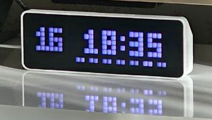

# ESPHome Pixel Clock aka TRAM

## Description

This repository provides a complete solution for **Ulanzi TC001** and custom `8×32` RGB LED matrix displays:

- **Core Component (`pixel-clock`):** The underlying [**ESPHome**](https://esphome.io/) custom component that powers the display. It is the actively maintained successor to [**EspHoMaTriXv2**](https://github.com/lubeda/EspHoMaTriXv2), originally created by [@lubeda](https://github.com/lubeda). Following the official end of development of the original project at version `2026.9.1`, this repository continues its maintenance, bug fixes, and compatibility updates for modern ESPHome releases.
- **Ready-to-Use Configurations:** Modular YAML configurations tailored specifically for the **Ulanzi TC001** hardware.
- **Pre-built Firmware:** Ready-to-flash binaries for quick installation via Web browser or [**ESPHome**](https://esphome.io/).

## Documentation

Full documentation, configuration guides, screen modes, and examples are available on the project website:

👉 [**Pixel Clock Documentation**](https://andrewjswan.github.io/pixel-clock/)

## Firmware
You can install the firmware using [ESPHome](https://esphome.io/) using one of the ready-made configuration files or use [**PixelClock - ESP Web Tools**](https://andrewjswan.github.io/pixel-clock/firmware.html) - a convenient tool for installing and updating the firmware of ESP32 devices in the browser.

## 🤝 Support
If you like the project, you can support it with a star ⭐ on GitHub.
