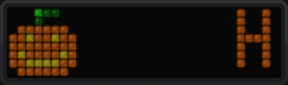
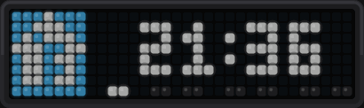
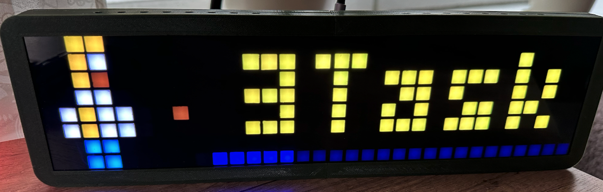
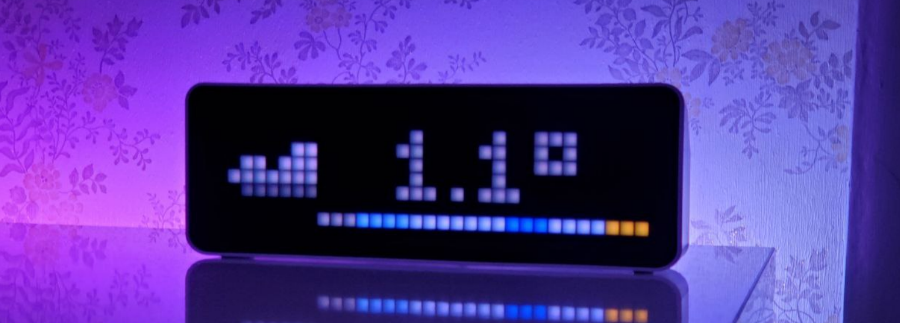
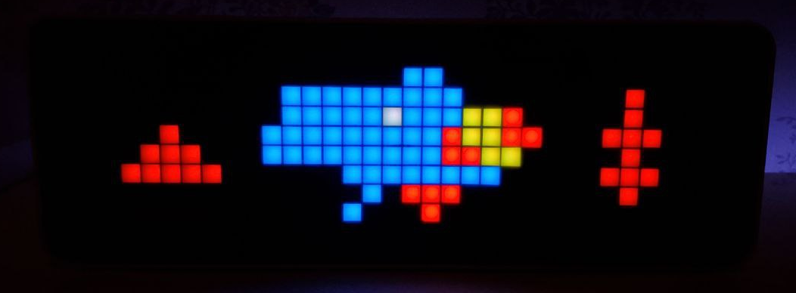

## Screens

### MODE_ICON_SCREEN



!!! example annotate "Icon screen"

    ``` { .yaml .copy .annotate }
    service: esphome.pixel_clock_icon_screen
    data:
      default_font: true
      icon_name: pumpkin
      text: Halloween
      lifetime: 2
      screen_time: 10
      r: 255
      g: 165
      b: 0
    ```

!!! tip "Pumpkin icon"

    To use the Pumpkin icon, you need to add it to the configuration.

    For example, icon **1574** from the website [Lametric](https://developer.lametric.com/icons)

    [More info](pixel-clock-component.md#icons-and-animations)

### MODE_TEXT_SCREEN

!!! example annotate "Text-Only Screen"

    ``` { .yaml .copy .annotate }
    service: esphome.pixel_clock_text_screen
    data:
      text: Your message
      lifetime: 2
      screen_time: 10
      r: 200
      g: 200
      b: 200
    ```

### MODE_RAINBOW_ICON

!!! example annotate "Rainbow Icon Screen"

    ``` { .yaml .copy .annotate }
    service: esphome.pixel_clock_rainbow_icon_screen
    data:
      icon_name: solar
      text: colorful text
      lifetime: 2
      screen_time: 10
    ```

### MODE_ICON_CLOCK



!!! example annotate "Icon Clock"

    ``` { .yaml .copy .annotate }
    service: esphome.pixel_clock_icon_clock
    data:
      icon_name: calendar|day#1
      lifetime: 2
      screen_time: 10
      default_font: true
      r: 200
      g: 200
      b: 200
    ```

### MODE_ALERT_SCREEN

!!! example annotate "Alert Screen (immediate display, no lifetime)"

    ``` { .yaml .copy .annotate }
    service: esphome.pixel_clock_alert_screen
    data:
      icon_name: home_assistant
      text: Important!
      screen_time: 10
      r: 20
      g: 180
      b: 240
    ```

### MODE_ICON_PROGRESS



!!! example annotate "Progress Screen (basic service call)"

    ``` { .yaml .copy .annotate }
    service: esphome.pixel_clock_icon_screen_progress
    data:
      icon_name: print3d
      text: 67% done
      progress: 67
      lifetime: 2
      screen_time: 9
    ```

!!! example annotate "Progress Screen"

    ``` { .yaml .copy .annotate }
    alias: Pixel Clock - Power
    trigger:
      - platform: state
        entity_id: sensor.home_power
        id: over
      - platform: numeric_state
        entity_id: sensor.home_power
        below: 5000
        id: normal
    condition:
      - condition: template
        value_template: >
          {{ trigger.id == 'normal' or (trigger.id == 'over' and states('sensor.home_power') | int(0) > 5000) }}
    action:
      - action: esphome.pixel_clock_icon_screen_progress
        data:
          icon_name: power
          text: "{{ (states('sensor.home_power') | int(0) / 1000) | round(1) }}kW"
          progress: "{{ -1 * (states('sensor.home_power') | int(0) / 100) | round(0) }}"
          lifetime: "{{ 5 if states('sensor.home_power') | int(0) > 1000 else 3 }}"
          screen_time: 5
          default_font: true
          r: >-
            {{
              240 if states('sensor.home_power') | int(0) > 5000 else
              240 if states('sensor.home_power') | int(0) > 1000 else
              0
            }}
          g: >-
            {{
              0 if states('sensor.home_power') | int(0) > 5000 else
              240 if states('sensor.home_power') | int(0) > 1000 else
              240
            }}
          b: 0
    mode: restart
    ```

### MODE_BITMAP_STACK_SCREEN

!!! example annotate "Bitmap Stack (multiple icons)"

    ``` { .yaml .copy .annotate }
    service: esphome.pixel_clock_bitmap_stack
    data:
      icons: solar,power,temp,error
      lifetime: 2
      screen_time: 10
    ```

### MODE_PROGNOSIS_SCREEN



!!! example annotate "Prognosis Screen"

    ``` { .yaml .copy .annotate }
    service: esphome.pixel_clock_icon_prognosis_screen
    data:
      icon_name: weather_sunny
      text: 22°C
      prognosis: "[49,184,219, 49,219,139, 110,210,40, 255,255,40, 248,126,39]" # (1)!
      lifetime: 5
      screen_time: 10
      default_font: true
    ```

    1. Must contain 24 RGB triplets (72 integer values in total) representing the 24-pixel bar at the bottom of the screen.

!!! tip "Home Assistant"
    Additional examples and screenshots are available at the [link](https://github.com/lubeda/EspHoMaTriXv2/issues/149)

### MODE_BITMAP_SCREEN



!!! warning
    This feature is only available on ESP32 platform !!!

For **8x32** images as text. You can generate these images with, e.g., [Bitmap Editor](bitmap-editor.md) or just open the [Bitmap Converter](converter.md) and select the images you want. This tool will automatically scale and convert your images into the correct **RGB565** format for the `bitmap_screen` service.

!!! example annotate "Service via API"

    ``` { .yaml .copy .annotate }
    bitmap_screen => {"[0,4523,0,2342,0,..... (256 values 16bit values rgb565)]", "lifetime", "screen_time"}
    ```

!!! example annotate "Lambda"

    ``` { .c .copy .annotate }
    void bitmap_screen(string text, int lifetime=D_LIFETIME, int screen_time=D_SCREEN_TIME);
    ```

### MODE_BLANK

!!! example annotate "Blank Screen"

    ``` { .yaml .copy .annotate }
    service: esphome.pixel_clock_blank_screen
    data:
      lifetime: 2
      screen_time: 120
    ```

## Queue Management

!!! tip "Managing Screens in the Queue"

    You can remove active screens from the display queue or force a specific screen to appear immediately using the `del_screen` and `force_screen` services.

    !!! example annotate "Remove a screen from the queue"

        ``` { .yaml .copy }
        service: esphome.pixel_clock_del_screen
        data:
          icon_name: power
          mode: 5
        ```

    !!! example annotate "Force a screen to display immediately"

        ``` { .yaml .copy }
        service: esphome.pixel_clock_force_screen
        data:
          icon_name: solar
          mode: 5
        ```

    *(Refer to the [Screens and Modes](pixel-clock-component.md#screens-and-modes) table for the corresponding `mode` numeric values).*
